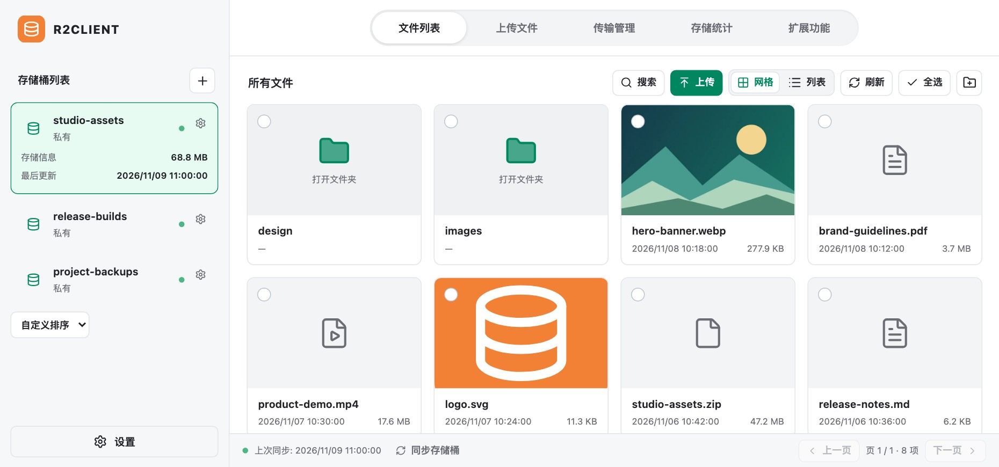

<h1 align="center">R2Client</h1>

An open-source Cloudflare R2 desktop client for macOS, Windows, and Linux.

<a href="README.md">简体中文</a> · English

  <a href="https://github.com/Cansiny0320/R2Client/actions/workflows/verify.yml?query=branch%3Amain+is%3Asuccess">Download</a> ·
  <a href="docs/hosting.md">Password sharing setup (Chinese)</a> ·
  <a href="https://github.com/Cansiny0320/R2Client/issues">Issues</a> ·
  <a href="#support">Support</a>

## Features

- Manage multiple accounts and buckets, search and preview files, and move, copy, or delete objects in bulk.
- Upload files, folders, clipboard contents, or URLs with resumable transfers and deduplication. Sync folders to your computer on a schedule.
- Share public or presigned links. [Password-protected links](docs/hosting.md) need a separate service. Transcoding and compression require [FFmpeg](https://ffmpeg.org/download.html).

## Support

If you find R2Client useful, scan a QR code below to support it via WeChat Pay or Alipay.

[MIT](LICENSE)
