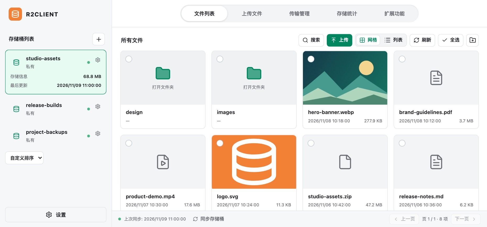

<h1 align="center">R2Client</h1>

开源 Cloudflare R2 桌面客户端，支持 macOS、Windows 和 Linux。

简体中文 · <a href="README.en.md">English</a>

  <a href="https://github.com/Cansiny0320/R2Client/actions/workflows/verify.yml?query=branch%3Amain+is%3Asuccess">下载安装</a> ·
  <a href="docs/hosting.md">密码分享部署</a> ·
  <a href="https://github.com/Cansiny0320/R2Client/issues">问题反馈</a> ·
  <a href="#赞赏">赞赏</a>

## 功能

- 管理多个账号和桶，搜索、预览文件，批量移动、复制或删除对象。
- 上传文件、目录、剪贴板内容或 URL，支持分片、续传和上传去重；也可定时同步目录到本机。
- 分享公开链接或临时签名链接；[密码分享](docs/hosting.md)需单独部署。转码和压缩需安装 [FFmpeg](https://ffmpeg.org/download.html)。

## 赞赏

觉得好用的话，欢迎通过[赞赏页面](https://image.cansiny.top/sponsor)用微信或支付宝支持。

[MIT](LICENSE)
